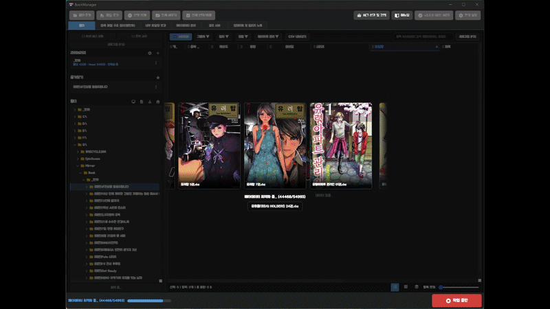
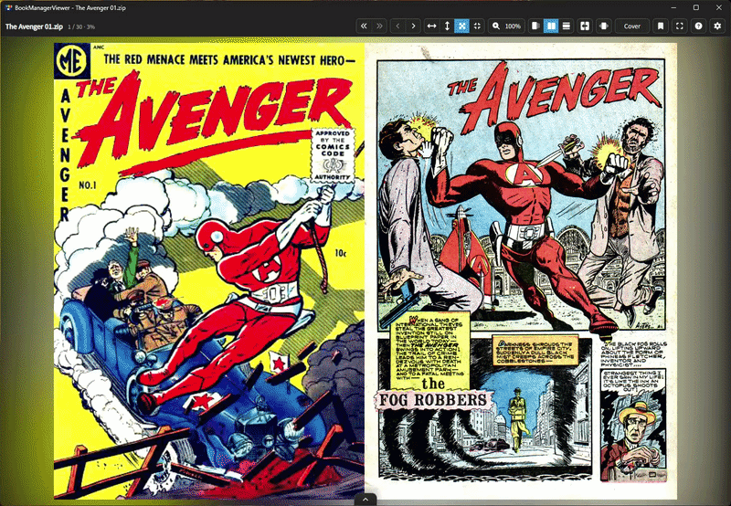

# BookManager

> The app supports Korean, English, and Japanese. This README and the [Wiki](https://github.com/dongkkase/BookManager/wiki) are written in Korean.

**모아 둔 책을 찾기 쉽게, 읽기 편하게.**

BookManager는 만화책, 전자책, 텍스트 문서와 오디오북을 위한 Windows/macOS용 서재 관리 앱입니다. 컴퓨터와 외장하드, NAS에 흩어진 책을 한곳에서 탐색하고, 파일 정리와 책 정보 편집부터 읽기·듣기와 기기 간 공유까지 이어갈 수 있습니다.

쌓여 가는 파일을 정돈하고 싶은 분, 표지와 시리즈 정보로 서재를 꾸미고 싶은 분, 다양한 형식의 책을 하나의 앱에서 즐기고 싶은 분을 위해 만들었습니다.

[최신 버전 다운로드](https://github.com/dongkkase/BookManager/releases/latest) · [사용 설명서](https://github.com/dongkkase/BookManager/wiki)

## 흩어진 책을 한곳에서

책이 여러 폴더와 저장 장치에 나뉘어 있어도 하나의 라이브러리처럼 살펴볼 수 있습니다. 표지 중심의 썸네일 보기와 목록·타일 보기를 제공하며, 별칭과 그룹으로 나만의 서재를 구성합니다.

- **원하는 책 찾기** — 파일명과 책 정보는 물론, 장르·작가·출판사 등 여러 조건으로 라이브러리를 검색합니다. 텍스트를 포함한 EPUB·PDF·TXT는 본문 검색도 지원합니다.
- **소장 목록 정리** — 파일명과 권수 정보를 바탕으로 중복 후보를 찾고, 시리즈에서 빠진 권·화 번호를 확인합니다.
- **읽던 책 다시 만나기** — 즐겨찾기와 최근 읽은 책을 모아 보고, 마지막 읽은 위치에서 독서를 이어갑니다.

## 반복되는 파일 정리를 간편하게

권별로 나뉘지 않은 압축 파일, 여러 겹의 폴더, 제각각인 이미지 이름을 정리합니다. 여러 파일에 같은 규칙을 적용할 수 있어 소장 자료의 형식을 맞추는 데 도움이 됩니다.

- **압축 파일 구조 정리** — 여러 권·화가 들어 있는 파일을 나누고 중첩된 폴더 구조를 정돈합니다.
- **내부 파일명 변경** — 페이지 순서와 이름을 맞추고, 불필요한 이미지 제외와 이미지 용량 줄이기를 함께 처리합니다.
- **텍본 정리기** — 불필요한 공백과 문장 중간 개행을 정리하고, 원본과 결과를 비교하며 본문을 직접 다듬습니다.

## 표지와 책 정보가 있는 서재

제목과 작가, 시리즈와 권수, 표지와 소개를 더해 소장한 책을 알아보기 쉽게 관리합니다. 같은 시리즈의 공통 정보를 한 번에 편집하고, 기존 책 정보를 재사용해 반복 입력을 줄일 수 있습니다.

리디북스, 알라딘, Google Books 등 여러 검색 소스에서 책 정보를 찾고, 파일 형식에 맞춰 메타데이터와 표지를 저장합니다. 표지로 제목 후보를 찾는 **AI 원제 찾기**와 외국어 검색 결과 번역도 지원합니다.

검색 소스와 편집·저장 범위는 파일 종류에 따라 다릅니다. 일부 검색 및 AI 기능에는 별도 API 키가 필요합니다.

## 읽는 방식에 맞춘 뷰어와 낭독

만화책부터 EPUB, PDF, TXT까지 내장 뷰어에서 읽을 수 있습니다. 문서 종류에 맞는 한 장·두 장 보기와 스크롤, 읽기 테마와 페이지 색을 반영하는 배경으로 독서 환경을 조절합니다. 썸네일 탐색, 본문 검색과 책갈피로 원하는 장면과 구절을 다시 찾을 수 있습니다.

- **텍스트를 음성으로** — EPUB과 TXT를 시스템 음성, 로컬 Supertonic 3 모델 또는 OpenAI·Google Cloud TTS로 듣습니다. 로컬 모델은 최초 다운로드 후 기기에서 음성을 생성합니다.
- **오디오북도 함께** — 재생 속도, 재생목록과 연속 재생, 북마크와 취침 타이머를 제공하며, 미니 플레이어로 다른 작업 중에도 들을 수 있습니다.
- **익숙한 뷰어와 연결** — 만화책, EPUB, PDF와 TXT는 형식별 외부 뷰어를 지정할 수 있습니다.

외부 TTS 서비스에는 별도 인증 정보가 필요합니다.

## 스마트폰과 태블릿으로 이어지는 서재

컴퓨터에 보관한 라이브러리를 같은 네트워크의 다른 기기에서도 이용할 수 있습니다. OPDS·Web·WebDAV 공유를 통해 지원하는 리더 앱이나 웹 브라우저에서 책을 탐색하고 가져옵니다.

[Readive](https://dongkkase.github.io/BookManager/readive/)와 연결하면 모바일 기기에서 라이브러리를 둘러보거나, BookManager에서 선택한 책과 폴더를 기기로 전송할 수 있습니다. 공유·전송 중에는 BookManager와 해당 공유 기능이 실행 중이어야 합니다.

## 화면으로 살펴보기

압축 파일 구조 정리와 내부 파일명 변경의 작업 예시입니다. 현재 버전의 화면과 차이가 있을 수 있습니다.

<kbd></kbd>
<kbd></kbd>

## 지원 환경과 다운로드

| 항목 | 지원 범위 |
| --- | --- |
| Windows | x64 포터블 앱 |
| macOS | Intel 및 Apple Silicon용 Universal 앱 |
| 앱 언어 | 한국어, 영어, 일본어 |

[최신 릴리즈](https://github.com/dongkkase/BookManager/releases/latest)에서 운영체제에 맞는 ZIP 파일을 내려받아 압축을 풀고 실행할 수 있습니다. 설치 안내와 자세한 사용법은 [Wiki](https://github.com/dongkkase/BookManager/wiki)에서 확인할 수 있습니다.

| 종류 | 라이브러리·뷰어 대상 형식 |
| --- | --- |
| 만화책 | ZIP, CBZ, RAR, CBR, 7Z, CB7 |
| 전자책·문서 | EPUB, PDF, TXT |
| 오디오북 | AAC, AIF/AIFF, FLAC, M4A/M4B, MP3, OGA/OGG/OPUS, WAV/WAVE, 3GP, AMR, CAF, WEBM |

파일 형식에 따라 읽기·편집·저장 지원 범위가 다르며, 오디오 재생 가능 여부는 코덱에 따라 달라질 수 있습니다.

## 개인정보와 라이선스

오류 보고와 기능 사용 통계는 기본으로 켜져 있으며, 환경 설정의 개인정보에서 각각 변경할 수 있습니다. 이 보고에는 책 제목·본문·메타데이터·파일 경로·검색어를 보내지 않습니다. 수집 범위와 전송 중단에 관한 자세한 내용은 [오류 보고 및 사용 통계 문서](README.telemetry.md)에 안내되어 있습니다.

BookManager는 [MIT 라이선스](LICENSE)로 공개되는 오픈소스 프로젝트입니다. 앱 안의 라이선스 메뉴에서도 저작권과 라이선스 원문, [서드파티 고지](THIRD_PARTY_NOTICES.md)를 확인할 수 있습니다. 외부 검색·AI·TTS 서비스에는 해당 서비스의 이용 조건과 요금이 적용될 수 있습니다.

## 더 알아보기

- [프로젝트 소개](https://dongkkase.github.io/BookManager/)
- [사용 설명서 · Wiki](https://github.com/dongkkase/BookManager/wiki)
- [오류 제보 · 기능 요청](https://github.com/dongkkase/BookManager/issues)
- [Discord 커뮤니티](https://discord.gg/DRVUbPewaV)
